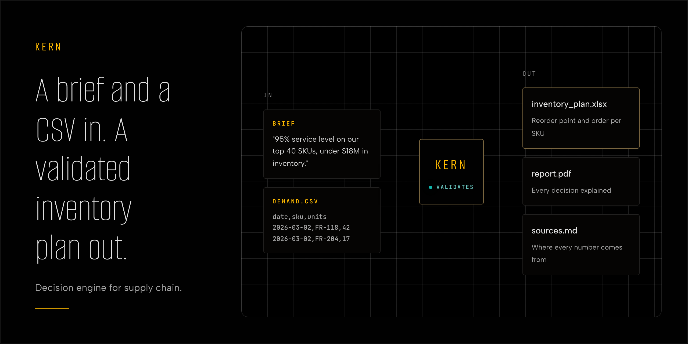
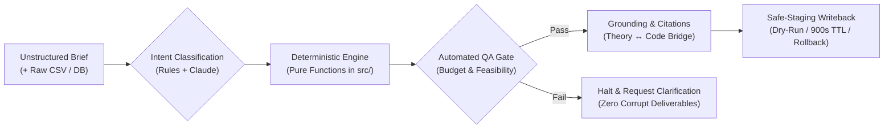
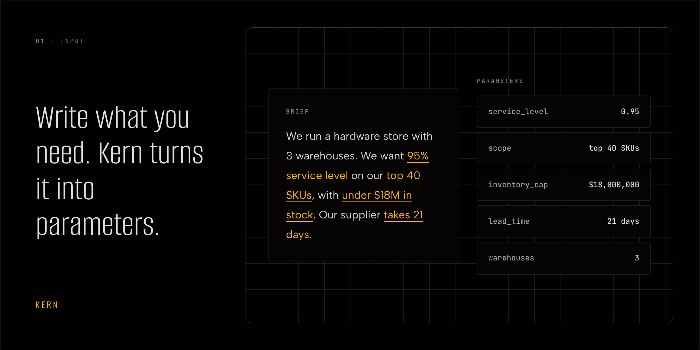
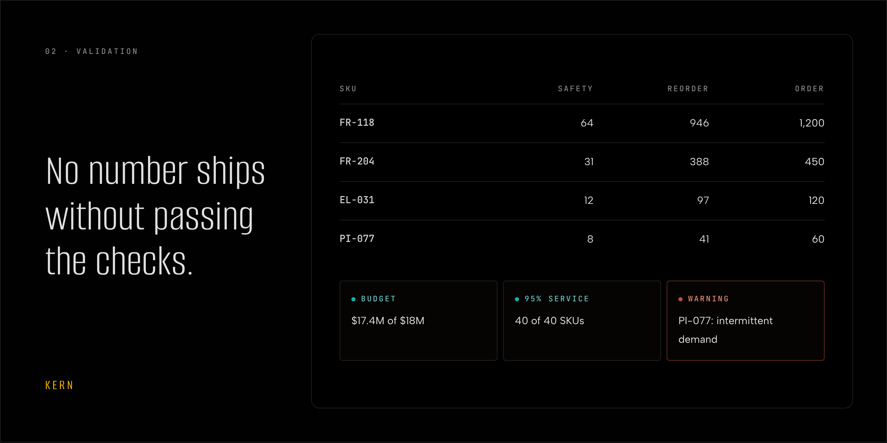
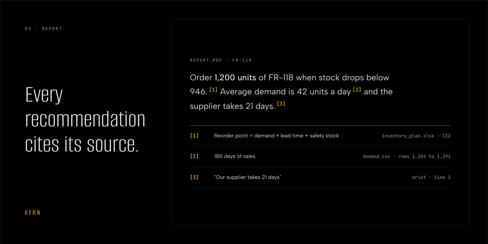
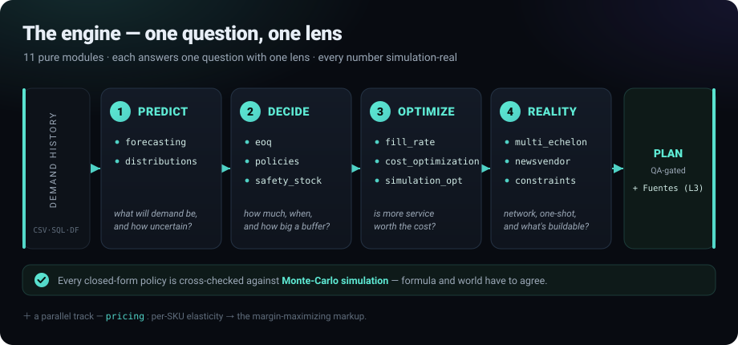
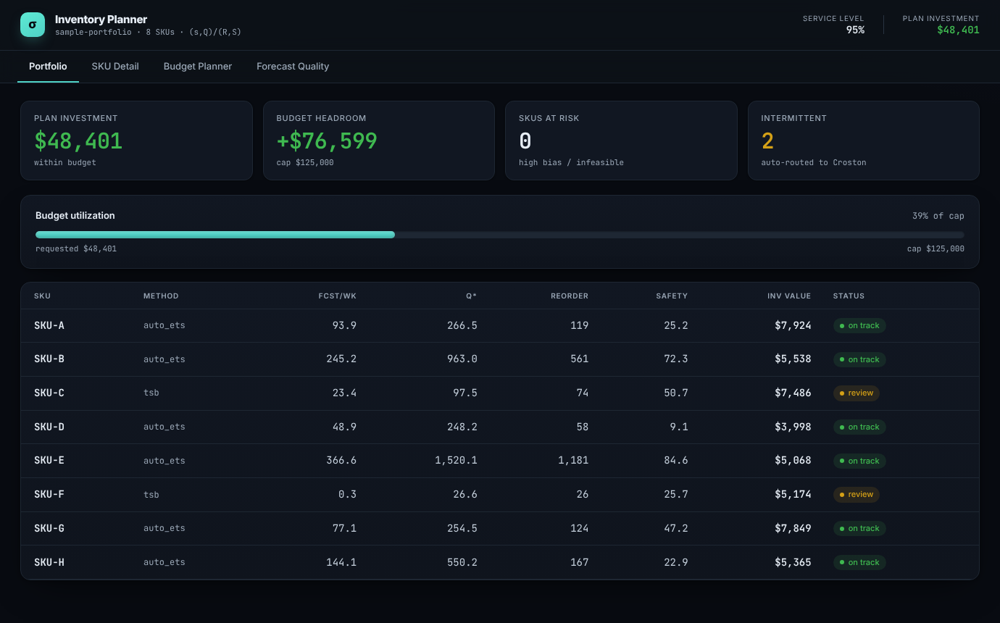
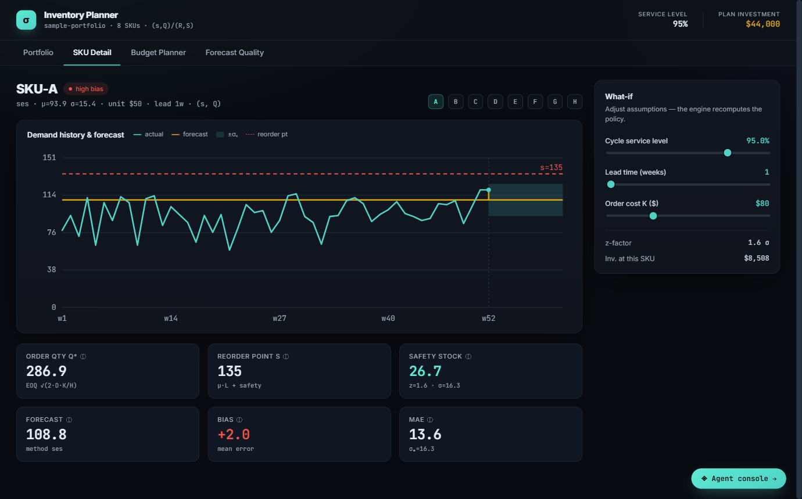
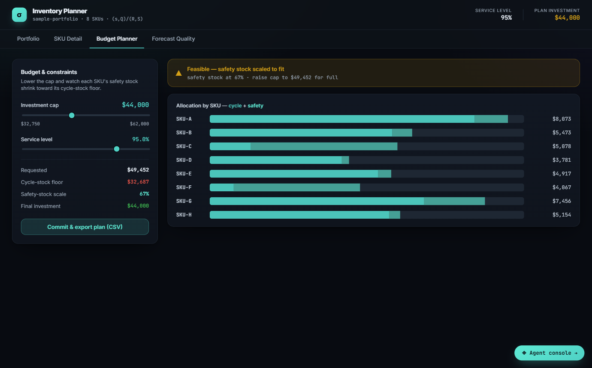
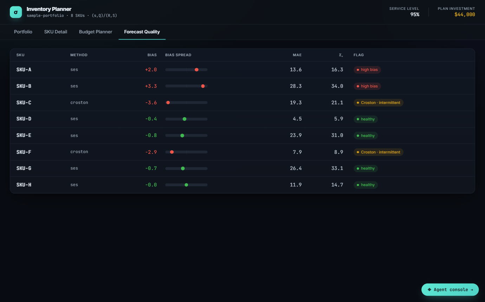

<div align="center">

# 🔗 Kern
### The Deterministic SCM Decision Engine & MCP Server

**A high-precision analytical engine and agentic orchestrator for enterprise supply chain operations.**  
Turns unstructured business briefs and raw transactional datasets into mathematically grounded, QA-gated supply chain deliverables—backed by **9,100+ tests** and zero unvalidated ledger mutations.

[](pyproject.toml)
[](tests/)
[](#)
[](docs/MCP_SERVER.md)
[](src/)
[](LICENSE)

<br/>



<sub>The live web console (<code>webapp/static/prototype/</code>) executing against the production <code>POST /api/jobs</code> runtime.</sub>

</div>

---

## ⚡ Executive Summary

Enterprise supply chain planning is plagued by two extremes: **fragile spreadsheet models** that fail to capture demand volatility, and **unconstrained LLM assistants** that hallucinate critical purchase order quantities and reorder thresholds.

**Kern resolves this chasm through a strict architectural invariant:**

$$\textbf{LLMs reason and translate} \quad \longleftrightarrow \quad \textbf{Deterministic code computes and guards}$$

1. **Pure Mathematical Engine:** Every inventory policy, replenishment calculation, and price elasticity metric is computed by a pure functional Python core (`src/`), cross-validated against Monte Carlo simulations.
2. **Deterministic QA Gates:** Deliverables are subjected to automated validation checks (budget feasibility, service-level guarantees, non-negative bounds). **If QA checks fail, zero deliverables ship.**
3. **Safe-Staging Writeback:** The orchestrator never mutates an enterprise system of record blindly. Ledger adjustments are staged as dry-run changesets with strict TTLs, risk classification, and one-click rollback mechanisms.
4. **Epistemological Grounding:** Every figure links back to an academic and empirical knowledge graph spanning **27 curated SCM reference sources** alongside the exact `src/` modules that executed the calculation.

---

## 🔄 How It Works: The 3-Step Lifecycle



<details open>
<summary><b>Inspect the 3-step visual execution flow</b></summary>
<br/>

**1 · Brief & Intake — Unstructured parameters parsed into deterministic constraints.**


**2 · Validation — Zero numbers released without passing deterministic boundary checks.**


**3 · Grounded Reporting — Mathematical formulas linked to source citations and code.**


</details>

---

## ⚙️ The Engine: One Question, One Lens

The analytical core stands on a decoupled chain of pure functions. Every numerical model is cross-checked against reference benchmarks and closed-form simulations:

<div align="center">



</div>

| The Operational Question | Engine Module | Analytical Lens & Methodological Advantage |
|:---|:---|:---|
| *How much should we order?* | [`src/eoq.py`](src/eoq.py) | **Cost Balance:** Exact trade-off between holding costs and fixed order costs, with tiered volume discounts. |
| *When should we reorder?* | [`src/policies.py`](src/policies.py) | **Trigger & Risk:** Dynamic `(s,Q)` continuous review and `(R,S)` periodic review policies. |
| *How large must the buffer be?* | [`src/safety_stock.py`](src/safety_stock.py) | **Uncertainty Grounding:** Calculated off **forecast error $\sigma_e$**, eliminating the catastrophic industry mistake of using raw demand variance $\sigma_{\text{demand}}$. |
| *What service will customers realize?* | [`src/fill_rate.py`](src/fill_rate.py) | **Realized Availability:** Computes fill rate ($\beta$) to evaluate true volume served, separating it from cycle service level ($\alpha$). |
| *How to handle intermittent demand?* | [`src/forecasting.py`](src/forecasting.py) | **Shape-Awareness:** Croston's method and Gamma distributions for lumpy, skewed SKUs where Gaussian models stock out. |
| *Where should inventory sit in the network?* | [`src/multi_echelon.py`](src/multi_echelon.py) | **Systemic Optimization:** Guaranteed Service Model (GSM) across multi-echelon warehouse tiers. |
| *What price maximizes gross margin?* | [`src/pricing.py`](src/pricing.py) | **Empirical Elasticity:** Per-SKU price elasticity curves determining margin-maximizing markups and markdown liquidation. |
| *Is the plan operationally feasible?* | [`src/constraints.py`](src/constraints.py) | **Floor Reality:** Hardware limits, supplier MOQs, case packs, shelf-life caps, and working capital budget allocation. |

<div align="center">


<sub>Demonstrated **15%+ median cost reduction** against standard heuristic baselines across public benchmark retail datasets (Online Retail I & II, Superstore).</sub>

</div>

---

## 🧰 Capabilities Architecture: 4 Operational Pillars

Kern organizes its **60 agent-routable capabilities** across four integrated pillars, routed transparently via `scm_agent/orchestrator.py`:

```
┌────────────────────────────────────────────────────────────────────────┐
│                        KERN CAPABILITY TAXONOMY                        │
├───────────────────────────┬────────────────────────────────────────────┤
│ 1. INVENTORY & POLICIES   │ • Stochastic (s,Q) / (R,S) Policy Engine   │
│                           │ • Multi-Echelon GSM & Digital Twin Sim     │
│                           │ • DDMRP Buffer Sizing & FEFO Perishables   │
├───────────────────────────┼────────────────────────────────────────────┤
│ 2. PRICING & MARGINS      │ • Price Elasticity & Optimal Markups       │
│                           │ • Competitor Position & Market Intel       │
│                           │ • Markdown Liquidation & Cost-to-Serve     │
├───────────────────────────┼────────────────────────────────────────────┤
│ 3. NETWORK & PHYSICAL OPS │ • Multi-Facility p-Median Network Design   │
│                           │ • Vehicle Routing & Dynamic Slotting       │
│                           │ • Transit Flow Mapping & Facility Location │
├───────────────────────────┼────────────────────────────────────────────┤
│ 4. GOVERNANCE & GATING    │ • Cross-Silo Campaign Launch Readiness    │
│                           │ • ERP Read-Replicas & Safe Writeback       │
│                           │ • ISO / SCOR Operational Evidence Packs    │
└───────────────────────────┴────────────────────────────────────────────┘
```

<details>
<summary><b>Inspect the complete 60-tool capability registry</b></summary>
<br/>

| Operational Area | Registered Capabilities |
|:---|:---|
| **Demand & Classification** | `abc_xyz` · `forecast` · `whatif` |
| **Inventory & Replenishment** | `inventory_optimization` · `newsvendor` · `multi_echelon` · `ddmrp` · `simulation` · `digital_twin` · `drp` · `odoo_replenishment` · `excel_replenishment` · `hat_tension` · `hat_settlement` · `shopify_replenishment` · `channel_replenishment` |
| **Inventory Health & Control** | `cycle_count` · `reconciliation` · `excess_obsolete` · `markdown_liquidation` · `fefo` · `data_quality` · `org_friction_audit` · `intake_scan` · `service_scan` |
| **Procurement & Sourcing** | `sourcing` · `supplier_management` (Kraljic) · `landed_cost` · `import_case` · `acceptance_sampling` |
| **Network & Physical Logistics** | `facility_location` · `network_design` (p-median) · `transportation` · `vehicle_routing` · `warehouse_layout` · `slotting` · `queuing` · `scheduling` · `flow_map` |
| **Pricing & Margin Management** | `pricing` · `price_intelligence` · `price_watch` · `repricing` · `financial_kpis` · `cost_to_serve` · `learning_curve` |
| **Risk, Returns & Disruption** | `returns` · `risk` · `dea` · `disruption_scan` (GDELT event feed integration) |
| **Cross-Silo Cadence & S&OP** | `sop` · `earned_value` · `launch_readiness` (Commercial vs Supply Chain gate) · `cross_impact` |
| **Operations & Audit Evidence** | `procedure_audit` · `procedure_draft` · `iso_ops` · `audit_evidence` (MUS sampling) · `scor_iso_audit` |

</details>

---

## 🛡️ Enterprise Safety Contracts

To guarantee operational safety in high-stakes environments, Kern implements three non-negotiable architectural contracts:

1. **The Never-Unprotected Guarantee:**  
   Every execution terminates in either an autonomous `EXECUTED` action (if confidence clears the target threshold) or a pre-structured human handoff (`OPTIONS`, `HANDOFF`, `ESCALATE`). The agent never leaves the operator at a dead end.
2. **Safe-Staging Writeback:**  
   Write operations to ERP systems (such as Odoo or SAP) are generated as dry-run diffs. Actions require approval based on risk tiers and are subject to time-boxed execution windows (default 900s TTL) with idempotent rollbacks.
3. **Data Protection by Default:**  
   Isolated per-job execution containers, automatic session purging, zero-persistence on uncommitted files, and strict threat model boundaries detailed in [`SECURITY.md`](SECURITY.md).

<div align="center">


</div>

---

## 🔌 Interfaces & Deployment

### 1. Model Context Protocol (MCP) Server
Kern exposes its analytical tools directly to Claude and compatible agent harnesses via the **Anthropic Model Context Protocol (MCP)**. External agents can request inventory calculations, elasticity evaluations, and network optimizations with guaranteed mathematical precision.  
*Reference:* [`docs/MCP_SERVER.md`](docs/MCP_SERVER.md).

### 2. Live Web Dashboard & Console
A high-performance FastAPI web layer providing real-time interactive dashboards and an operator console:

<table>
<tr>
<td width="50%"><br/><sub><b>Portfolio Overview:</b> Real-time working capital allocation and constraint headroom.</sub></td>
<td width="50%"><br/><sub><b>SKU Deep-Dive:</b> Demand history, Croston / Gamma dispersion, and reorder levels.</sub></td>
</tr>
<tr>
<td width="50%"><br/><sub><b>Budget Allocation:</b> Interactive safety stock vs. cycle stock optimization under cash caps.</sub></td>
<td width="50%"><br/><sub><b>Forecast Reliability:</b> Bias tracking and dispersion diagnostics per SKU.</sub></td>
</tr>
</table>

### 3. CLI & Programmatic API

```bash
# Execute end-to-end replenishment analysis
python examples/run_constrained_plan.py --lead-time 14 --service-level 0.95

# Query the grounded SCM knowledge base
python examples/query_knowledge.py --explain "crostons_method"
```

```bash
# HTTP API: Execute an end-to-end analytical brief
curl -X POST http://localhost:8000/api/jobs \
  -F "brief=Optimize replenishment for high-velocity SKUs with a $50,000 budget cap" \
  -F "file=@data/sample_demand.csv"
```

---

## 🏗️ Repository Structure

```
scm_agent/            Registry-based orchestrator (classify → run → QA → deliver)
src/                  Pure functional mathematical engine (EOQ, policies, safety stock, pricing, GSM)
webapp/               FastAPI dashboard, live agent console, and job API
jobs/                 Playbooks, intake schema validators, and output generators
knowledge/            Grounded knowledge graph (27 SCM reference texts and mathematical derivations)
examples/             CLI workflows, scenario benchmarks, and demonstration scripts
tests/                9,100+ comprehensive unit, integration, and numeric regression tests
docs/                 Architecture specifications, deployment runbooks, and MCP server docs
```

---

## 📄 License & Proprietary Core

* **Analytical Core & Agent Framework:** Proprietary. All rights reserved. Evaluation and enterprise deployment licensing available upon inquiry.
* **Third-Party Components:** Licensed under respective open-source terms (see [`THIRD_PARTY_NOTICES.md`](THIRD_PARTY_NOTICES.md)).
* **Odoo Connector:** Published under Odoo Proprietary License v1.0 (OPL-1) via [`odoo_addon/`](odoo_addon/).

---

<div align="center">
<sub>Engineered for frontline operational reliability. Designed to operate alongside the <a href="https://github.com/esstipi-debug/mellon">Mellon Framework</a>.</sub>
</div>
