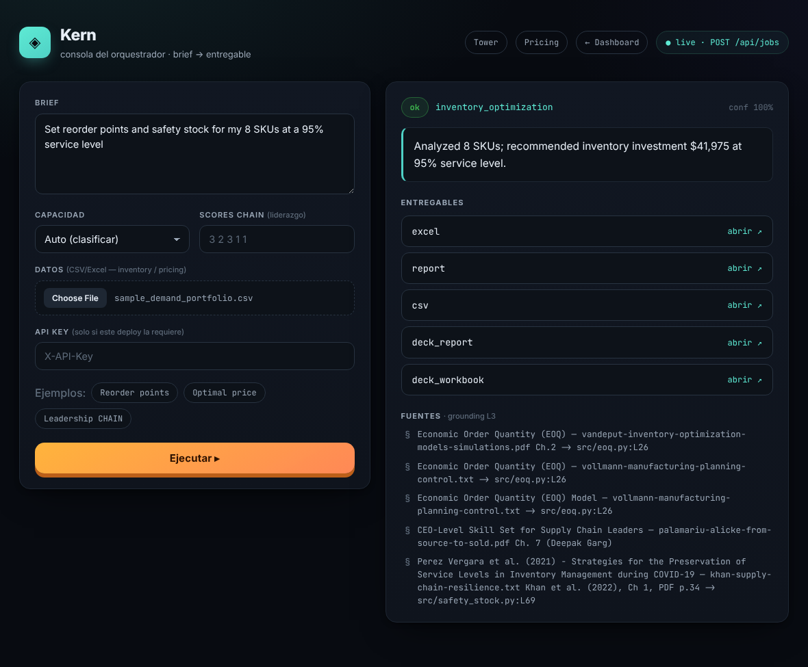
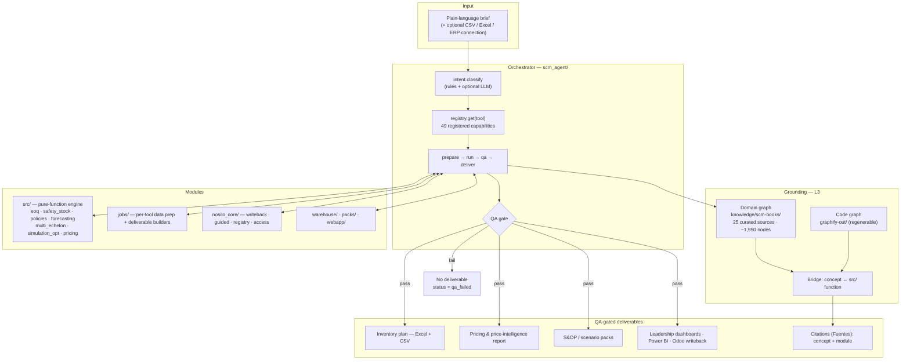
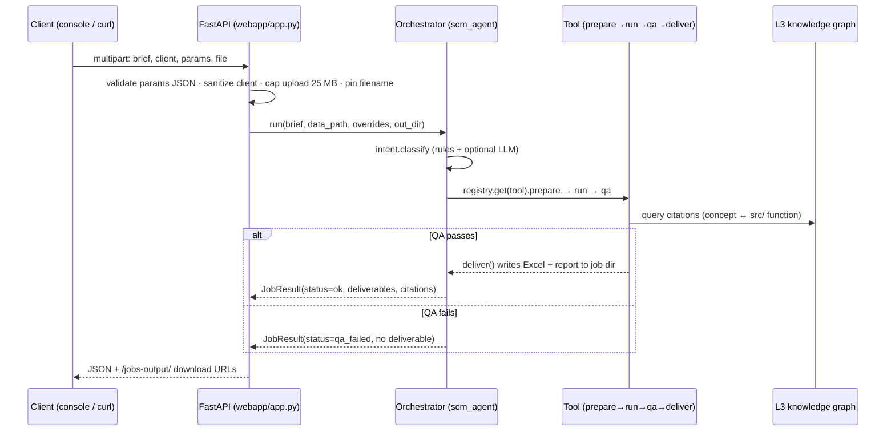

<div align="center">

# 🔗 Kern

### An agentic supply-chain engine: plain-language brief in, QA-gated deliverable out.

**Kern** turns a sentence like *"replenish my 400 SKUs within a $80k budget"* into a finished Excel plan, a written report and a chart — or into nothing at all, because a QA gate refuses to ship a deliverable it cannot defend. Behind it: a deterministic Python engine implementing the field's established models (EOQ, safety stock, `(s,Q)`/`(R,S)`, multi-echelon, newsvendor, simulation optimization, elasticity pricing), an orchestrator that routes **49 capabilities** through one pipeline, and a knowledge graph of **25 curated SCM sources** that grounds every number in both the source concept and the `src/` function that computes it.

**Highlights**

- **49 agent-routable capabilities**, one router — inventory, network design, pricing, sourcing, S&OP, warehouse, risk. Adding one is a single `register()` call, no routing edits.
- **QA-gated by construction** — `classify → prepare → run → QA → deliver`. QA fails ⇒ no deliverable. Enforced in one place, not per tool.
- **25-source SCM knowledge graph** (~1,950 concept nodes) bridged to the codebase: every result cites the concept *and* the module implementing it.
- **Never-unprotected contract** — every result is `EXECUTED`, or hands back ranked `OPTIONS`, a prepared `HANDOFF`, or an `ESCALATED` path. No dead ends, no silent autonomy.
- **Safe-staging writeback** — dry-run changeset → risk tier → time-boxed approval → idempotent apply → `rollback()`. Live connectors: Odoo ERP (XML-RPC) and client Excel workbooks.
- **Forward-deployable** — one Docker image, zero mandatory secrets, runs with or without an LLM; `fly.toml` / `railway.json` included, plus an Odoo add-on and a Power BI dataset for the client's existing stack.
- **1,100+ tests**, CI on Python 3.11–3.13, plus a `prod-boot` job that reproduces the production container's import surface.

[](CHANGELOG.md)
[](pyproject.toml)
[](https://github.com/esstipi-debug/kern/actions/workflows/tests.yml)
[](https://github.com/esstipi-debug/kern/actions/workflows/docker.yml)
[](#)
[](https://github.com/esstipi-debug/kern/commits/main)
[](LICENSE)
[](pyproject.toml)

</div>



<div align="center"><sub>The live agent console (<code>webapp/static/prototype/</code>) talking to the real <code>POST /api/jobs</code>.</sub></div>

---

## Use cases

Five scenarios the repository actually runs today. Each names the business problem and what building it required.

### 1. Multi-location replenishment under a hard budget

**Problem.** A distributor with several DCs has to place next month's orders against a cash ceiling. A spreadsheet computes a mathematically optimal quantity that operations cannot buy (MOQ, case packs, shelf life) or cannot fund.

**Kern.** `inventory_optimization` → forecast (exposing σ_e, forecast error, not raw demand spread) → `(s,Q)`/`(R,S)` policy → MOQ / case-pack / shelf-life constraints → a budget allocator that trims safety stock across the portfolio to fit. Closed-form policies are cross-checked against Monte-Carlo simulation. `multi_echelon` places the stock across stages instead of greedily per node.

**Demonstrates.** Stochastic inventory modeling, constrained optimization, and the discipline to make feasibility a first-class constraint rather than a post-hoc adjustment.

### 2. Price intelligence + margin optimization

**Problem.** Pricing decisions are made against last year's list price and a rumor about what a competitor charges.

**Kern.** `pricing` estimates per-SKU elasticity and returns the margin-maximizing price; `price_intelligence` computes competitor price position one-shot; `price_watch` auto-onboards a never-seen competitor site, homologates its product pages against your catalog, and monitors confirmed pairs on a cadence — **100% read-only**, robots.txt-gated, never writing a price anywhere.

**Demonstrates.** Web data acquisition with explicit legal and ethical invariants encoded as test-enforced constraints, entity matching, and econometric modeling wired into an operational loop.

### 3. Forward-deployed agent on top of a live ERP

**Problem.** The client already has an ERP. They do not want a new system of record; they want better decisions inside the one they have.

**Kern.** `odoo_replenishment` reads live inventory and sales over XML-RPC and stages restocks back as reorder rules; `excel_replenishment` does the same against the client's actual planilla (drift check vs the live file, atomic write, per-commit backup, cell-exact rollback, `.xlsm` macros preserved and never executed). Writeback is always a dry-run changeset gated by risk tier and a time-boxed approval.

**Demonstrates.** Integration engineering against messy real systems, and the operational judgment to treat a client's system of record as something you never mutate blindly — the core of a forward-deployed role.

### 4. S&OP scenario planning and cross-area objections

**Problem.** A decision that looks right for inventory quietly breaks procurement or logistics, and nobody objects until it is live.

**Kern.** `sop` builds the planning cadence; `whatif` runs scenarios; `hat_tension` maps the tension between four operating perspectives and `hat_settlement` produces a reconciled replenishment plan; `cross_impact` measures a proposed decision's effect on the other areas and issues an objection verdict against the client's thresholds — an area with no threshold returns `no_evaluable` and the global verdict is `indeterminado`, never a false "nobody objects".

**Demonstrates.** Process modeling beyond the math: encoding organizational trade-offs, and refusing to fabricate a confident answer where evidence is absent.

### 5. Leadership and operations dashboards for the client's stack

**Problem.** The analysis is right and nobody above the operations manager ever sees it.

**Kern.** A 4-tab FastAPI planner (Portfolio · SKU Detail · Budget Planner · Forecast Quality) with sliders that recompute the policy live, plus a Power BI dataset with M queries and DAX measures, an Odoo add-on, and Excel/CSV exports. `leadership_chain` scores a brief against the CHAIN model and returns a radar chart with directives.

**Demonstrates.** Full-stack delivery — the last mile from a correct number to a decision someone actually makes.

---

## Technical overview



**How it is designed.** The orchestrator is registry-based: every capability is a `Tool` with four stages (`prepare → run → qa → deliver`) that the orchestrator drives, so `"QA fails ⇒ no deliverable"` is enforced in exactly one place instead of 49. Intent classification is rules-first with an optional LLM refinement, which means the system degrades to a deterministic path rather than failing when no API key is present. The analytical layer under it is a set of pure functions — one module, one question, one lens — validated against reference numeric examples from the literature and cross-checked against Monte-Carlo simulation, so the policies are verified rather than asserted. Grounding is a read-only query surface over two graphs (the committed 25-source domain graph and a regenerable AST code graph) joined by a bridge that resolves each cited concept to the module implementing it. Quality gating is structural: each tool ships its own `qa()`, the orchestrator refuses to write deliverables when it fails, and the HTTP layer returns the same envelope with `status: qa_failed` and an empty `deliverables` map. Forward deployment is a single Docker image with zero mandatory secrets: the engine, web app and full test suite run without any key, hardening controls are opt-in environment variables, and the connectors (Odoo, Excel, Power BI) meet the client inside the stack they already own.

<details>
<summary><b>Request lifecycle — <code>POST /api/jobs</code></b></summary>



```json
{
  "status": "ok",
  "tool": "inventory_optimization",
  "confidence": 0.87,
  "summary": "12 SKUs · $44k budget · 3 flagged high-bias · (s,Q) for 9, (R,S) for 3.",
  "deliverables": {
    "report": "/abs/job/inventory_optimization/report.md",
    "excel": "/abs/job/inventory_optimization/inventory_plan.xlsx"
  },
  "qa_issues": [],
  "citations": [
    {"concept": "Safety Stock", "source": "SCM knowledge base", "module": "src/safety_stock.py"}
  ]
}
```

Statuses: `ok` · `needs_clarification` · `needs_data` · `qa_failed` · `error`.

</details>

<details>
<summary><b>All 49 capabilities, by area</b></summary>

Source of truth: `build_default_registry()` in [`scm_agent/tools.py`](scm_agent/tools.py). If this table and the code disagree, trust the code.

| Area | Tools |
|---|---|
| **Demand & classification** | `abc_xyz` · `forecast` · `whatif` |
| **Inventory & replenishment** | `inventory_optimization` · `newsvendor` · `multi_echelon` · `ddmrp` · `simulation` · `digital_twin` · `drp` · `odoo_replenishment` · `excel_replenishment` · `hat_tension` · `hat_settlement` |
| **Inventory control & health** | `cycle_count` · `reconciliation` · `excess_obsolete` · `markdown_liquidation` · `fefo` · `data_quality` · `org_friction_audit` |
| **Procurement & sourcing** | `sourcing` · `supplier_management` (Kraljic) · `landed_cost` · `acceptance_sampling` |
| **Network & logistics** | `facility_location` · `network_design` (p-median) · `transportation` · `vehicle_routing` · `warehouse_layout` · `slotting` · `queuing` · `scheduling` · `flow_map` |
| **Pricing & finance** | `pricing` · `price_intelligence` · `price_watch` · `financial_kpis` · `cost_to_serve` · `learning_curve` |
| **Returns, risk & benchmarking** | `returns` · `risk` · `dea` · `disruption_scan` (GDELT-fed) |
| **Planning cadence & projects** | `sop` · `earned_value` · `launch_readiness` · `cross_impact` |
| **Leadership** | `leadership_chain` |

</details>

<details>
<summary><b>The engine — one question, one lens</b></summary>

| The question | Module | The lens |
|---|---|---|
| *How much do I order?* | `src/eoq.py` | Cost balance — ordering vs holding cost (+ volume discounts). |
| *When do I reorder?* | `src/policies.py` | Trigger & risk — `(s,Q)`/`(R,S)`: reorder point *and* quantity. |
| *How big a buffer?* | `src/safety_stock.py` | Uncertainty — `z·σ_e·√τ`, keyed off **forecast error**, not raw demand spread. |
| *What service do I get?* | `src/fill_rate.py` | Realized service — fill rate β, not just cycle service α. |
| *Is more service worth it?* | `src/cost_optimization.py` | Economics — the service level that minimizes holding + shortage cost. |
| *Spiky or skewed demand?* | `src/forecasting.py` · `src/distributions.py` | Shape-aware — Croston, gamma. |
| *Where to hold stock?* | `src/multi_echelon.py` | System view — guaranteed-service placement. |
| *One perishable shot?* | `src/newsvendor.py` | Critical ratio `cu/(cu+co)`. |
| *Can't trust assumptions?* | `src/simulation_opt.py` | Empirical — search `(s,Q,S)` over thousands of demand paths. |
| *Is the plan feasible?* | `src/constraints.py` | MOQ, case packs, shelf life, budget allocator. |
| *What price maximizes margin?* | `src/pricing.py` | Elasticity → margin-maximizing markup. |

**Key formulas.** `Q* = √(2kD/h)` · `Ss = z_α · σ_e · √τ` (`(s,Q)`: τ = L; `(R,S)`: τ = R + L) · `(s,Q): s = dL + Ss, Q = Q*` · `(R,S): S = dL + dR + Ss`.

</details>

<details>
<summary><b>Project layout</b></summary>

```
scm_agent/            Orchestrator: brief → classify → tool (49 registered) → QA → deliver
nosilo_core/          Control plane: writeback · guided outcomes · registry · access
src/                  Pure-function engine (EOQ → simulation optimization → forecasting → pricing)
jobs/                 Per-tool data-prep playbooks + deliverable builders
webapp/               FastAPI dashboard + POST /api/jobs + live agent console + /mcp
warehouse/            Warehouse layout / slotting models
packs/                Composed multi-tool playbooks (e.g. source_to_pay)
odoo_addon/           Odoo module (staged dry-run writeback)
power-bi/             Dataset + M queries + DAX measures + SETUP.md
knowledge/scm-books/  L3 domain graph (25 curated sources, committed)
examples/             Runnable CLIs (run_agent, run_price_watch, query_knowledge, ...)
tests/                1,100+ tests: engine · agent · HTTP guards · e2e acceptance
.github/workflows/    CI: tests (3.11–3.13) · prod-boot · docker · price-watch cron
```

</details>

---

## Setup

Requires Python 3.11+. No secrets are needed: the engine, the web app and the full test suite run with zero keys.

```bash
git clone https://github.com/esstipi-debug/kern.git
cd kern
python -m venv .venv && source .venv/bin/activate   # Windows: .venv\Scripts\activate
pip install -r requirements-dev.txt                 # dev: everything, including tests
# or, production surface only:
pip install -e ".[web,mcp]"

cp .env.example .env                                # optional — every key is optional
```

### See it work in 15 seconds

```bash
make demo          # or: PYTHONPATH=. python examples/run_demo.py
```

Four briefs through the real orchestrator, against the committed sample data, with no keys and no network:

| Step | Brief | What it proves |
|---|---|---|
| 1 | *"replenishment plan for my portfolio within an $80k budget"* | forecast → `(s,Q)`/`(R,S)` → MOQ and budget fit, as an Excel plan |
| 2 | *"what price maximizes margin on these SKUs"* | per-SKU elasticity, plus an explicit *not enough signal* verdict |
| 3 | *"classify my portfolio by value and demand variability"* | where the value sits, and which SKUs are discontinuation candidates |
| 4 | the same replenishment brief, with an **unusable file** | **no deliverable** — it names the missing columns instead of inventing a plan |

Step 4 is the point of the other three, and the exit code depends on it: the demo fails unless the system also refuses correctly. Deliverables land in `output/demo/` with the source concept and the `src/` function behind each number.

### Everything else

```bash
make test                                           # or: PYTHONPATH=. pytest tests/ -q
make lint
make serve                                          # dashboard at /, agent console at /console
PYTHONPATH=. python examples/run_agent.py --brief "optimize inventory for my 12 SKUs, $44k budget" --data data/sample_demand.csv
PYTHONPATH=. python examples/query_knowledge.py --bridge "safety stock"
```

`make` is a convenience wrapper, not a requirement — `make help` lists every target, and each one is a single command you can run directly (useful on Windows, where `make` is usually absent).

### Docker

```bash
docker build -t kern .
docker run -p 8000:8000 -e PORT=8000 kern
```

The image installs `-e ".[web,mcp,pricing-intel,dataquality]"` and boots `uvicorn webapp.app:app`. A dedicated CI job (`prod-boot`) imports the app with **only** the production extras, so a module-level import of a dev-only dependency fails the PR instead of the deployment.

### Deploy

```bash
flyctl deploy                # fly.toml is in the repo
# Railway: railway.json is in the repo
```

### Environment variables

All optional; missing keys degrade to the deterministic path, never a crash. Full list in [`.env.example`](.env.example).

| Variable | Purpose |
|---|---|
| `ANTHROPIC_API_KEY` | LLM-assisted brief parsing + narrative. Without it: rules-based fallback. |
| `LINCHPIN_API_KEY` | Requires `X-API-Key` on `POST /api/jobs`. Unset = open. |
| `LINCHPIN_RATE_LIMIT` / `_WINDOW` | Sliding-window rate limit per client IP. |
| `LINCHPIN_APPROVAL_SECRET` | Signs writeback approvals so one cannot be forged. |
| `LINCHPIN_ENV` / `LINCHPIN_REQUIRE_SECURE` | Warn — or refuse to boot — on an unsecured production deploy. |
| `ODOO_URL` / `ODOO_DB` / `ODOO_USERNAME` / `ODOO_API_KEY` | Live Odoo connector. Unset = in-memory stand-in. |

> Infra identifiers still carry the `LINCHPIN_` prefix (the project's former name) on purpose — renaming them is a coordinated external change tracked in `HANDOFF.md`, not a cosmetic edit.

### Forward deployment notes

The design assumption is that the client already has a system of record and will not replace it. Kern deploys **beside** it:

- **Odoo** — [`odoo_addon/linchpin_dry_run`](odoo_addon/) is an installable module; `src/connectors/odoo.py` reads inventory and sales over XML-RPC and stages restocks as reorder rules. Nothing is applied without an approval.
- **Client Excel** — `src/connectors/excel.py` reads the actual planilla, checks drift against the live file, writes atomically (temp + replace), backs up per commit, and rolls back cell-exact. `.xlsm` macros are preserved and never executed.
- **Power BI** — [`power-bi/`](power-bi/) ships a dataset, M queries, DAX measures and a SETUP guide, so leadership reporting lands in the tool they already open.
- **Other AI agents** — a read-only MCP server is mounted at `/mcp` with per-client key issuance ([`docs/MCP_SERVER.md`](docs/MCP_SERVER.md)).
- **Hardening** — every control is an opt-in env var, documented with its threat model in [SECURITY.md](SECURITY.md) and [`docs/DEPLOYMENT.md`](docs/DEPLOYMENT.md): API key, rate limit, CORS allowlist, signed approvals, isolated per-job upload directories with auto-purge, and a production guard that refuses to boot unsecured.

What this shows about deployment capability: a single image, a documented threat model, a fallback path for every optional dependency, and a writeback protocol that assumes the client's data is not yours to break.

---

## SCM knowledge & QA

**The knowledge graph.** [`knowledge/scm-books/`](knowledge/scm-books/) holds a committed graph of **25 curated SCM sources** — roughly 1,950 concept nodes with source citations, spanning forecasting, inventory theory, pricing and revenue management, operations, logistics and network design, sustainability, leadership, and AI in supply chains. A second, regenerable graph indexes the codebase itself. A bridge joins them:

```text
Economic Order Quantity           ->  src/eoq.py
Safety Stock                      ->  src/safety_stock.py
Cost & Service-Level Optimization ->  src/cost_optimization.py
```

Every deliverable therefore carries **Fuentes**: the concept it rests on and the function that computed it. Query it directly with `examples/query_knowledge.py --bridge / --search / --explain`.

**The QA approach**, in four layers:

1. **Per-tool `qa()`** — each capability declares what makes its own output invalid.
2. **One enforcement point** — the orchestrator, not the tool, decides that a failed QA writes nothing. A new tool cannot forget to gate itself.
3. **Reference-validated engine** — closed-form results are checked against worked numeric examples from the literature and against Monte-Carlo simulation, across 1,100+ tests.
4. **Honest degradation** — no threshold means `no_evaluable`, not a passing grade; missing data means `needs_data`, not an invented number.

**Why this matters for the roles I target.** For a **Supply Chain Analyst / Engineer**: the models are the field's canon, applied correctly (σ_e rather than σ_demand for safety stock is the single most common error in production spreadsheets) and validated numerically. For a **Forward Deployed / Implementation Engineer**: grounding and QA are what make an AI system deployable at a client — a recommendation you can trace to a source and a line of code is auditable, and one that refuses to ship beats one that ships confidently wrong. For a **Customer-facing AI Engineer**: the never-unprotected contract is a product decision about where the human stays in the loop, and it is enforced in code, not in a slide.

---

## Why this project matters for my resume

- **AI agent design and orchestration** — a registry-based agent where 49 heterogeneous capabilities share one `classify → prepare → run → QA → deliver` contract, with a rules-first path that works when the LLM is absent. Extensibility is a `register()` call, not a refactor.
- **SCM process and domain modeling** — inventory policies, multi-echelon placement, network design, S&OP cadence, Kraljic segmentation and cross-area objection logic, implemented from primary sources rather than approximated.
- **Data pipelines and operational documentation** — pluggable sources (CSV / DataFrame / SQL), per-tool intake with pandas, Excel / Power BI / CSV exports, and documentation written for the operator running the engagement (`documentation/operator/`), not only for the developer.
- **Production and QA engineering** — 1,100+ tests, coverage gate, a CI matrix across three Python versions, a job reproducing the production container's import surface, a nightly unconstrained dependency resolve, and a documented threat model.
- **Integration under real-world constraints** — a live ERP connector, an Odoo add-on, an Excel writeback protocol with drift detection and cell-exact rollback, and an MCP server for other agents. All of it staged, approved and reversible.
- **Business ↔ engineering bridge** — the input is a sentence an operations manager would say; the output is a deliverable that person can act on. The design work in between (what the agent refuses to do, when a human must decide, how a number is justified) is exactly the forward-deployed job.

---

## Roadmap

Full issue bodies, labels and suggested priority order: [`documentation/ROADMAP.md`](documentation/ROADMAP.md).

| # | Item | Why it matters | Suggested labels |
|---|---|---|---|
| 1 | Auto-generate the capability table from `build_default_registry()` — the drift *guard* already ships (`tests/test_readme_capability_drift.py`) | Documentation that lies is worse than none. The guard catches divergence; a generator would fix it in one command | `documentation`, `automation`, `good first issue` |
| 2 | Publish the container image to GHCR on tagged releases | A client should be able to `docker pull` a versioned image instead of building from source | `enhancement`, `devops` |
| 3 | ~~Per-tool run metrics~~ — **shipped** (`nosilo_core/metrics.py`, exposed at `GET /api/metrics`); next: propagate the request ID down into the orchestrator | `qa_failed` is now counted per tool, so a gate that stops biting is visible. What's missing is tracing one deliverable back to one request | `observability`, `enhancement` |
| 4 | Complete the `linchpin` → `kern` identifier rename (env vars, MCP tool names, Odoo module) | The public name and the infra names diverge; the migration checklist already exists in `HANDOFF.md` | `chore`, `breaking-change` |
| 5 | A second ERP connector (SAP B1 or NetSuite) behind the existing writeback protocol | Proves the connector abstraction generalizes past Odoo — the main objection to a forward-deployed pitch | `integration`, `enhancement` |
| 6 | ~~One-command `make demo`~~ — **shipped**; next: a larger, messier demo dataset | The four-step demo runs on the small committed samples; a realistic dirty dataset would exercise the QA gate harder | `documentation`, `dx` |
| 7 | Contract tests for the MCP surface | The `/mcp` server is a public API for other agents; it needs its own regression suite | `testing`, `integration` |
| 8 | Per-tool accuracy tracking feeding the T1/T2/T3 autonomy tiers | Autonomy is earned from measured accuracy; the measurement loop should be automatic | `enhancement`, `research` |
| 9 | English translation of the operator documentation | `documentation/operator/` is the most differentiated material in the repo and is currently Spanish-only | `documentation` |
| 10 | Benchmark suite on public datasets, run in CI with published deltas | Turns "median cost reduction vs baseline" from a claim into a reproducible artifact | `testing`, `benchmark` |

---

## Docs

| Document | Content |
|---|---|
| [Getting Started](documentation/GETTING_STARTED.md) | Setup and first run |
| [Methodology](documentation/METHODOLOGY.md) | Models, assumptions, glossary |
| [FAQ](documentation/FAQ.md) | Common questions |
| [`scm_agent/README.md`](scm_agent/README.md) | The agent reference |
| [Security](SECURITY.md) | Threat model, enforced controls, hardening checklist |
| [Deployment](docs/DEPLOYMENT.md) | Production hardening: env controls, reverse proxy, load notes |
| [MCP Server](docs/MCP_SERVER.md) | Read-only analysis access for other AI agents |
| [Case Studies](case-studies/CASE_STUDIES.md) | Worked numeric examples against reference values |
| [Contributing](CONTRIBUTING.md) · [Changelog](CHANGELOG.md) | Workflow and history |

---

<div align="center">
<sub>MIT licensed. Built and maintained by <a href="https://github.com/esstipi-debug">@esstipi-debug</a>.</sub>
</div>
