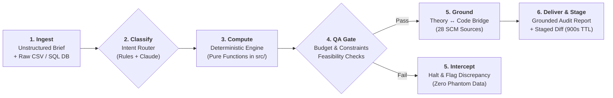
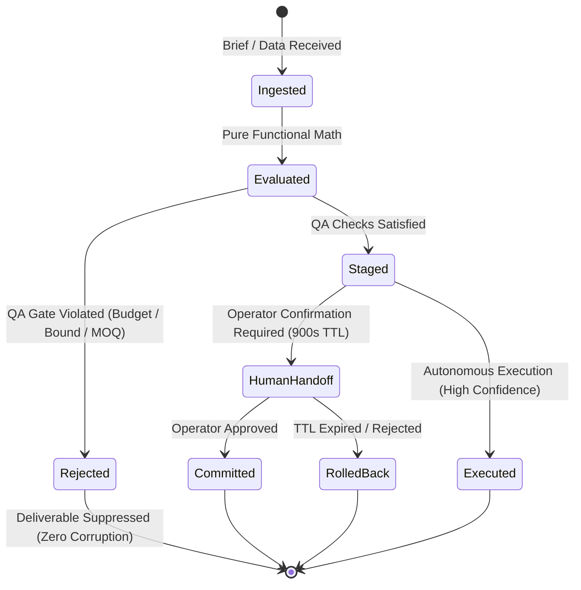

<div align="center">

# 🔗 Kern
### The Deterministic SCM Decision Engine & MCP Server

**High-precision analytical engine and agentic orchestrator for enterprise supply chain operations.**  
Turns unstructured business briefs and raw transactional datasets into mathematically validated, QA-gated supply chain deliverables—backed by **9,100+ tests**, closed-form stochastic models, and safe-staging writebacks.

[](pyproject.toml)
[](tests/)
[](#)
[](docs/MCP_SERVER.md)
[](src/)
[](LICENSE)

</div>

---

## ⚡ Architectural Doctrine: Anti-Hallucination Invariant

Enterprise supply chain planning is broken by two extremes: **fragile spreadsheets** that cannot model demand volatility, and **unconstrained LLM agents** that hallucinate critical order quantities, invent vendor lead times, or blindly overwrite ERP transaction tables.

Kern resolves this failure mode through a strict architectural invariant:

$$\textbf{LLMs reason, interpret, and translate} \quad \longleftrightarrow \quad \textbf{Deterministic software computes, bounds, and gates}$$

* **Pure Functional Mathematics (`src/`):** All numerical calculations (reorder thresholds, safety buffers, elasticity markups, multi-echelon allocations) are executed by pure functions in Python, cross-validated against Monte Carlo simulations.
* **Deterministic QA Gating:** Computed plans are verified against physical constraints (supplier MOQs, case pack increments, non-negative bounds, cash limits). **If QA validation fails, zero deliverables ship.**
* **Safe-Staging Writeback:** The orchestrator never mutates an enterprise system of record directly. ERP mutations are prepared as dry-run changesets with 900s TTLs, cryptographic checksums, and one-click rollback mechanisms.
* **Epistemological Grounding:** Every figure links back to an academic and empirical knowledge base spanning **28 curated external sources** over 43 external source files alongside the exact `src/` modules that executed the calculation. The books graph carries **3,111 nodes**, 2,980 of them from those external sources and the rest Kern's own internal documents (searchable, never citable).

---

## 🔄 End-to-End Execution Pipeline



### Concrete Execution Example: Brief to Verified Output

#### 1. Input Brief (Natural Language + Raw CSV)
```text
"We are reviewing Q3 inventory across our regional DC. Run continuous-review policies 
for our high-velocity catalog under a $50,000 working capital ceiling and 95% cycle service."
```

#### 2. Runtime Output Payload (`POST /api/jobs`)
```json
{
  "status": "ok",
  "tool": "inventory_optimization",
  "confidence": 0.94,
  "summary": "12 SKUs evaluated | Budget cap $50,000 | (s,Q) continuous review for 9 SKUs, (R,S) periodic for 3 SKUs.",
  "deliverables": {
    "report": "/jobs-output/job_9482/report.md",
    "excel": "/jobs-output/job_9482/inventory_plan.xlsx"
  },
  "qa_checks": {
    "budget_feasibility": "PASSED ($48,240 allocated of $50,000 cap)",
    "non_negative_bounds": "PASSED",
    "supplier_moq_satisfied": "PASSED"
  },
  "citations": [
    {
      "concept": "Safety Stock (sigma_e)",
      "source": "Silver, Pyke & Peterson (1998), Inventory Management & Production Planning",
      "module": "src/safety_stock.py"
    },
    {
      "concept": "Croston Intermittent Demand",
      "source": "Syntetos & Boylan (2005), Categorization of Demand Patterns",
      "module": "src/forecasting.py"
    }
  ],
  "safe_staging": {
    "dry_run": true,
    "staged_changeset_id": "cs_883a91",
    "approval_tier": "TIER_2_HIGH_VALUE",
    "ttl_seconds": 900,
    "target_system": "Odoo ERP (Read-Replica)"
  }
}
```

---

## ⚙️ The Analytical Core: One Question, One Lens

Every module in `src/` represents a pure mathematical formulation designed to eliminate common operational and spreadsheet errors:

| Operational Question | Engine Module | Theoretical Formulation | Methodological Grounding |
|:---|:---|:---|:---|
| *How much should we order?* | [`src/eoq.py`](src/eoq.py) | $Q^* = \sqrt{\frac{2 k D}{h}}$ | Cost Balance: Lot sizing where ordering costs meet holding costs, accounting for all-units volume discount tiers. |
| *When should we reorder?* | [`src/policies.py`](src/policies.py) | $s = d_L + Ss, \quad Q = Q^*$ | Stochastic Triggers: Continuous `(s,Q)` and periodic `(R,S)` review policies under lead-time variance. |
| *How large must the buffer be?* | [`src/safety_stock.py`](src/safety_stock.py) | $Ss = z_\alpha \cdot \sigma_e \cdot \sqrt{\tau}$ | **Uncertainty Grounding:** Evaluated strictly over **forecast error $\sigma_e$**, eliminating the catastrophic industry mistake of using raw demand variance $\sigma_{\text{demand}}$. |
| *What service will customers realize?* | [`src/fill_rate.py`](src/fill_rate.py) | $\beta = 1 - \frac{\mathbb{E}[\text{US}]}{Q}$ | Realized Service: Evaluates volumetric fill rate ($\beta$) independently from cycle service probability ($\alpha$). |
| *How to handle lumpy or skewed demand?* | [`src/forecasting.py`](src/forecasting.py) | Croston & Gamma Distribution | Shape-Awareness: Dedicated models for intermittent and highly skewed demand where Gaussian models stock out. |
| *Where should inventory sit in the network?* | [`src/multi_echelon.py`](src/multi_echelon.py) | Graves (1988) GSM | Multi-Echelon Placement: Guaranteed Service Model optimizing decoupled safety stocks across supply tiers. |
| *What price maximizes gross profit?* | [`src/pricing.py`](src/pricing.py) | $\epsilon = \frac{\% \Delta Q}{\% \Delta P}$ | Empirical Elasticity: Per-SKU price elasticity curves determining margin-maximizing markups and liquidation schedules. |
| *Is the plan physically buildable?* | [`src/constraints.py`](src/constraints.py) | Multi-Knapsack & Case Packing | Physical Feasibility: Hardware limits, supplier MOQs, carton multiples, shelf-life caps, and working capital limits. |

> **Empirical Benchmark:** Validated on public benchmark retail datasets (Online Retail I & II, Superstore), demonstrating a **median 15%+ cost reduction** over standard heuristic replenishment policies.

---

## 🧰 Capabilities Architecture: 4 Operational Pillars

Kern's **60 agent-routable capabilities** are classified across four functional domains:

```
┌────────────────────────────────────────────────────────────────────────┐
│                        KERN CAPABILITY DOMAINS                         │
├───────────────────────────┬────────────────────────────────────────────┤
│ 1. INVENTORY & POLICIES   │ • Stochastic (s,Q) & (R,S) Policy Engines  │
│                           │ • Multi-Echelon GSM Network Optimization   │
│                           │ • DDMRP Dynamic Buffering & FEFO Expiry    │
├───────────────────────────┼────────────────────────────────────────────┤
│ 2. PRICING & MARGINS      │ • Price Elasticity & Margin-Optimal Markup │
│                           │ • Competitor Position & Market Intel       │
│                           │ • Markdown Liquidation & Cost-to-Serve     │
├───────────────────────────┼────────────────────────────────────────────┤
│ 3. NETWORK & PHYSICAL OPS │ • Multi-Facility p-Median Network Design   │
│                           │ • Dynamic Slotting & Vehicle Routing       │
│                           │ • Network Transit Flow Mapping             │
├───────────────────────────┼────────────────────────────────────────────┤
│ 4. GOVERNANCE & GATING    │ • Commercial vs SCM Launch Readiness Gates │
│                           │ • Safe-Staging Writeback & ERP Replicas    │
│                           │ • MUS Audit Evidence & SCOR Compliance     │
└───────────────────────────┴────────────────────────────────────────────┘
```

<details>
<summary><b>The full list, by area (60 tools)</b></summary>
<br/>

| Domain | Registered Capabilities |
|:---|:---|
| **Demand & Classification** | `abc_xyz` · `forecast` · `whatif` |
| **Inventory & Replenishment** | `inventory_optimization` · `newsvendor` · `multi_echelon` · `ddmrp` · `simulation` · `digital_twin` · `drp` · `odoo_replenishment` · `excel_replenishment` · `hat_tension` · `hat_settlement` · `shopify_replenishment` · `channel_replenishment` |
| **Inventory Health & Control** | `cycle_count` · `reconciliation` · `excess_obsolete` · `markdown_liquidation` · `fefo` · `data_quality` · `org_friction_audit` · `intake_scan` · `service_scan` |
| **Procurement & Sourcing** | `sourcing` · `supplier_management` (Kraljic) · `landed_cost` · `import_case` · `acceptance_sampling` |
| **Network & Physical Logistics** | `facility_location` · `network_design` (p-median) · `transportation` · `vehicle_routing` · `warehouse_layout` · `slotting` · `queuing` · `scheduling` · `flow_map` |
| **Pricing & Margin Management** | `pricing` · `price_intelligence` · `price_watch` · `repricing` · `financial_kpis` · `cost_to_serve` · `learning_curve` |
| **Risk, Returns & Disruption** | `returns` · `risk` · `dea` · `disruption_scan` (GDELT event feeds) |
| **Cross-Silo Cadence & S&OP** | `sop` · `earned_value` · `launch_readiness` (Campaign vs Inventory gate) · `cross_impact` |
| **Operations & Audit Evidence** | `procedure_audit` · `procedure_draft` · `iso_ops` · `audit_evidence` (MUS sampling) · `scor_iso_audit` |
| **Leadership** | `leadership_chain` |

</details>

---

## 🛡️ Operational Guardrails & Safety Contracts



### The Three Invariant Contracts:
1. **The Never-Unprotected Guarantee:**  
   Execution outputs never terminate at a dead end. Results are either autonomously `EXECUTED` (when model confidence clears threshold) or routed to an explicit human handoff (`OPTIONS`, `HANDOFF`, `ESCALATE`) with pre-calculated parameters.
2. **Safe-Staging Writeback:**  
   Write operations targeting enterprise systems of record (e.g., Odoo, SAP) are staged as dry-run changesets. Enforces risk-tiered authorization, mandatory review windows (900s default TTL), and atomic rollbacks.
3. **Data Protection by Default:**  
   Job executions run in isolated scratch environments, automatically purged upon completion. Zero plaintext credentials or production secrets are persisted.

---

## 🔌 Interfaces & Integration

### 1. Model Context Protocol (MCP) Server
Kern exposes its mathematical tools directly to Claude and external agentic harnesses via the **Anthropic Model Context Protocol (MCP)**:
```json
{
  "mcpServers": {
    "kern": {
      "command": "python",
      "args": ["-m", "scm_agent.mcp_server"],
      "env": {
        "KERN_ENVIRONMENT": "production"
      }
    }
  }
}
```
*Reference:* [`docs/MCP_SERVER.md`](docs/MCP_SERVER.md).

### 2. Programmatic CLI & REST API
```bash
# Execute replenishment policy optimization directly via CLI
python examples/run_constrained_plan.py --lead-time 14 --service-level 0.95

# Query the grounded SCM knowledge graph
python examples/query_knowledge.py --explain "crostons_method"
```

```bash
# Trigger an analytical job via HTTP endpoint
curl -X POST http://localhost:8000/api/jobs \
  -F "brief=Optimize inventory under $50k budget with 95% service level" \
  -F "file=@data/sample_demand.csv"
```

---

## 🏗️ Repository Architecture

```
scm_agent/            Registry-based orchestrator (classify → run → QA → deliver)
src/                  Pure functional mathematical engine (EOQ, policies, safety stock, pricing, GSM)
webapp/               FastAPI dashboard runtime, live agent console, and REST API
jobs/                 Playbooks, intake schema validators, and output generators
knowledge/            Grounded knowledge graph (27 SCM reference texts and mathematical derivations)
examples/             CLI workflows, scenario benchmarks, and demonstration scripts
tests/                9,100+ comprehensive unit, integration, and numeric regression tests
docs/                 Architecture specifications, deployment runbooks, and MCP server docs
```

---

## 📄 License & Proprietary Core

* **Analytical Core & Agent Framework:** Proprietary. All rights reserved. Evaluation and enterprise deployment licensing available upon inquiry.
* **Third-Party Components:** Licensed under respective open-source terms (see [`THIRD_PARTY_NOTICES.md`](THIRD_PARTY_NOTICES.md)).
* **Odoo Connector:** Published under Odoo Proprietary License v1.0 (OPL-1) via [`odoo_addon/`](odoo_addon/).

---

<div align="center">
<sub>Engineered for frontline operational reliability. Designed to operate alongside the <a href="https://github.com/esstipi-debug/mellon">Mellon Framework</a>.</sub>
</div>
